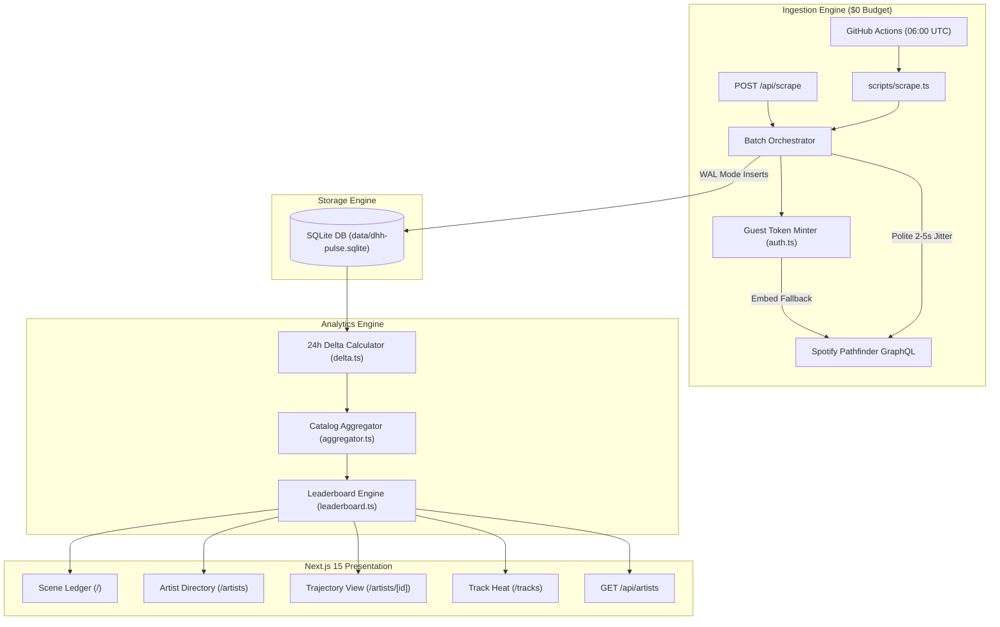

# DHH Pulse

Stream intelligence and audience analytics platform for the Desi Hip Hop music ecosystem.

## 1. Overview

DHH Pulse is an automated, high-throughput analytics application that tracks song playcounts, derives daily stream increases, captures audience metrics, and visualizes catalog momentum for over 20 flagship Desi Hip Hop artists and their discographies.

The official Spotify Web API restricts access to exact track playcounts and monthly listeners, exposing only relative popularity scores. DHH Pulse resolves this limitation by interfacing directly with Spotify's internal Pathfinder GraphQL API via anonymous guest sessions, calculating derived 24-hour stream growth through snapshot differentiation with negative-delta clamping guards, and rendering an industrial dark console dashboard.

The platform operates on a $0 infrastructure budget, executing ingestion, persistence, analytics, and presentation using an embedded SQLite WAL database and Next.js 15.

---

## 2. Key Features

- **Scene Ledger (`/`):** Real-time aggregate view of scene-wide 24-hour stream output, active artist momentum, top gainers, and batch execution status.
- **Artist Directory (`/artists`):** Interactive directory supporting 5 ranking dimensions (`totalDailyStreams`, `monthlyListeners`, `listenerDelta`, `followers`, `topTrackStreams`) with client-side name search.
- **Artist Deep-Dive (`/artists/[id]`):** Historical growth curves comparing monthly listener trajectories, 30-day stream curves, and track-level breakdown.
- **Track Heat (`/tracks`):** Scene-wide ranking of the fastest-gaining tracks over the last 24 hours.
- **Autonomous Scraper CLI (`scripts/scrape.ts`):** Standalone Node.js tool supporting full discography discovery, quick stream updates, and single-artist targeted updates.
- **Automated Ingestion:** Scheduled daily data collection via GitHub Actions (`workflows/daily-scrape.yml`).

---

## 3. Technology Stack

- **Framework:** Next.js 15.0.4 (App Router, Server and Client Components)
- **Runtime and Language:** Node.js 20+, TypeScript 5.7.2 (Strict Mode, Branded Types)
- **UI and Styling:** React 19, Tailwind CSS v4.0.0
- **Data Visualization:** Recharts 2.13.3
- **Database:** SQLite 3 via `better-sqlite3` v11.5.0 (WAL Journal Mode, 100% Parameterized Statements)
- **Testing:** Vitest 2.1.8 (48 unit tests)
- **Ingestion:** Spotify Pathfinder GraphQL with dual-tier anonymous guest token acquisition

---

## 4. Architecture Overview



Detailed architectural specifications:
- [System Architecture](docs/architecture/architecture.md)
- [System Design](docs/architecture/system-design.md)
- [Database Design](docs/architecture/database-design.md)
- [HTTP API Reference](docs/architecture/api-reference.md)
- [Architecture Decisions (ADRs)](docs/architecture/decisions/)

---

## 5. Mathematical Delta Model

Spotify tracks accumulate lifetime streams continuously. Daily stream metrics are derived mathematically:

$$\Delta \text{Streams}_{\text{track}, t} = \max\left(0, \, \text{Playcount}_{\text{track}, t} - \text{Playcount}_{\text{track}, t-1}\right)$$

### Negative Delta Clamping
To guard against anomalies caused by Spotify metadata deduplication, track re-releases, or ISRC consolidation, negative daily deltas are clamped strictly to zero.

### Catalog Rollup
$$\text{Total Daily Streams}_{\text{artist}, t} = \sum_{i \in \text{catalog}} \Delta \text{Streams}_{i, t}$$

### Audience Growth (Signed)
$$\Delta \text{Listeners}_{\text{artist}, t} = \text{MonthlyListeners}_t - \text{MonthlyListeners}_{t-1}$$

---

## 6. Project Structure

```
dhh-pulse/
|-- .agent-state/              # Autonomous agent state machine and audit reports
|-- .github/                   # GitHub templates and governance (CODEOWNERS, templates)
|-- data/                      # Local SQLite database storage (git-ignored)
|-- docs/
|   |-- architecture/          # Architecture, system design, DB design, API spec, ADRs
|   |-- design/                # Design philosophy, color tokens, and UI guidelines
|   |-- development/           # Development setup, coding standards, and testing guide
|   |-- deployment/            # Deployment and operational runbooks
|   |-- DOCUMENTATION_AUDIT.md # Repository documentation audit report
|-- scripts/                   # Standalone CLI tools (scripts/scrape.ts)
|-- src/
|   |-- app/                   # Next.js 15 App Router pages and API routes
|   |-- components/            # Reusable UI, layout, chart, and table components
|   |-- config/                # Artist registry source-of-truth (artists.ts)
|   |-- lib/
|   |   |-- analytics/         # Delta engine, catalog aggregator, leaderboard logic
|   |   |-- db/                # SQLite client singleton and schema definitions
|   |   |-- scraper/           # Pathfinder GraphQL queries, token minter, orchestrator
|   |-- types/                 # Central domain contracts (src/types/contracts.ts)
|-- workflows/                 # Scheduled CI/CD automation workflows
|-- AGENTS.md                  # Multi-agent architecture and governance specification
|-- AUTHORS.md                 # Contributor attribution and team roles
|-- CHANGELOG.md               # Version history and notable changes
|-- CONTRIBUTING.md            # Contribution guidelines and pull request instructions
|-- COPYRIGHT                  # Intellectual property and copyright notice
|-- LICENSE                    # Software license agreement
|-- NOTICE                     # Third-party notices and trademark disclaimers
|-- README.md                  # Project entry point
|-- SECURITY.md                # Security policy and vulnerability reporting
```

---

## 7. Prerequisites

- **Node.js:** v20.x or higher
- **npm:** v10.x or higher
- **SQLite 3:** (Bundled automatically via `better-sqlite3` native binaries)

---

## 8. Installation

```bash
# Clone repository
git clone https://github.com/divyprj/dhh-pulse.git
cd dhh-pulse

# Install dependencies strictly from package-lock.json
npm ci
```

---

## 9. Environment Configuration

Copy the template configuration file:

```bash
cp .env.example .env.local
```

Configurable variables:
- `NODE_ENV`: Runtime environment (`development`, `production`, `test`). In `development`, SQL query logging is enabled.
- `PORT`: HTTP port for Next.js web server (default: `3000`).
- `SCRAPE_TRIGGER_TOKEN`: Optional secret string. When defined, calls to `POST /api/scrape` must supply matching `x-scrape-token` or `Authorization: Bearer` headers.

---

## 10. Running Locally

```bash
# Start development server
npm run dev
```

Open [http://localhost:3000](http://localhost:3000) to view the console.

---

## 11. Usage: Running the Scraper

The scraper runs standalone via `npx tsx scripts/scrape.ts`:

```bash
# Full discography discovery across all 21 active artists
npm run scrape

# Quick update (updates audience stats and known tracks; skips release discovery)
npx tsx scripts/scrape.ts --quick

# Scrape a specific artist by Spotify Artist ID
npx tsx scripts/scrape.ts --artist 5C1S9XwxMuuCciutwMhp5t

# Custom request pacing delay (ms)
npx tsx scripts/scrape.ts --delay 4000
```

For complete scraper details, see [docs/architecture/system-design.md](docs/architecture/system-design.md).

---

## 12. Testing

The test suite runs via Vitest, executing 48 unit tests with isolated database mocks:

```bash
# Run unit tests
npm test

# Run tests in watch mode
npm run test:watch

# Validate TypeScript types
npm run type-check
```

Detailed testing guide: [docs/development/testing.md](docs/development/testing.md).

---

## 13. Deployment

Because DHH Pulse uses `better-sqlite3`, it requires a persistent filesystem and should be hosted on a persistent Node.js environment (VPS, dedicated server, or Docker container with volume mounts) rather than ephemeral serverless platforms.

Production build and execution:
```bash
npm run build
npm run start
```

Detailed deployment guide: [docs/deployment/deployment.md](docs/deployment/deployment.md).

---

## 14. Known Limitations

- **Pathfinder Schema Dependency:** Spotify's internal Pathfinder GraphQL API is undocumented and subject to unannounced upstream schema modifications.
- **Serverless Incompatibility:** Ephemeral serverless platforms (e.g. Vercel Functions, AWS Lambda) do not support persistent local SQLite databases without external volume mounting.
- **Guest Token Rate Limits:** Excessive scraping from a single IP address without polite jitter will trigger temporary rate limits (HTTP 429) from Spotify edge servers.

---

## 15. License and Ownership

- **Author and Owner:** Divyansh (`surajdivyansh104@gmail.com` / [@divyprj](https://github.com/divyprj)).
- **License:** Proprietary. Copyright (c) 2026 Divyansh. All rights reserved. See [LICENSE](LICENSE) and [COPYRIGHT](COPYRIGHT).
- **Third-Party Disclaimers:** Spotify is a registered trademark of Spotify AB. See [NOTICE](NOTICE).
