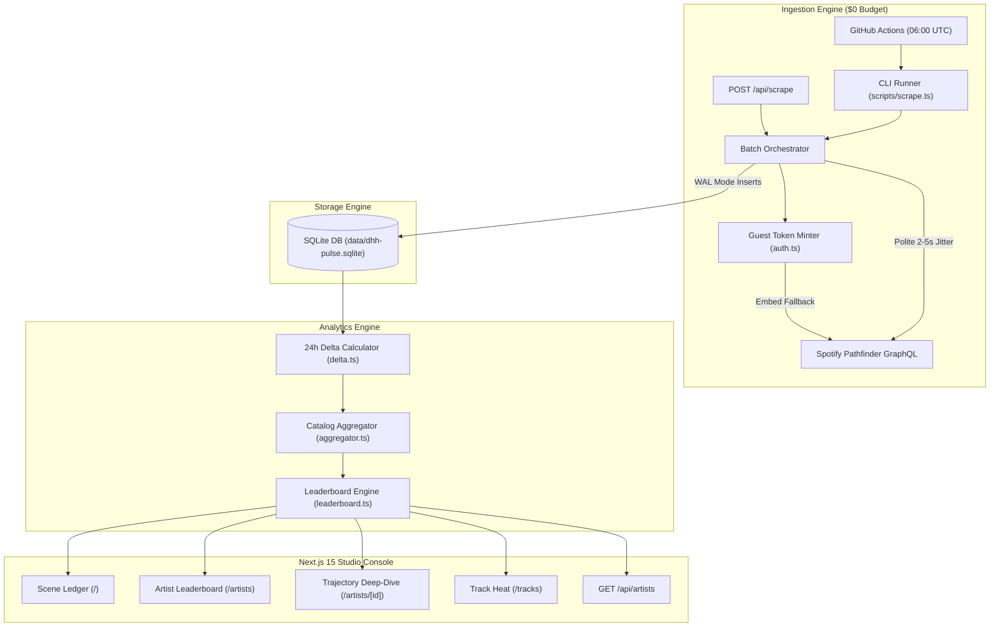

# DHH Pulse — Desi Hip Hop Spotify Intelligence

[](https://nextjs.org/)
[](https://react.dev/)
[](https://www.typescriptlang.org/)
[](https://tailwindcss.com/)
[](https://www.sqlite.org/)
[](https://vitest.dev/)
[](docs/FRONTEND.md)
[](docs/ARCHITECTURE.md)

**DHH Pulse** is an automated, high-throughput stream intelligence and audience analytics platform dedicated to the **Desi Hip Hop (DHH)** ecosystem. The platform tracks, analyzes, and visualizes exact lifetime playcounts, derived 24-hour stream growth, monthly listener dynamics, and catalog performance for 20+ flagship DHH artists (including KR$NA, Seedhe Maut, MC Stan, DIVINE, Raftaar, Talha Anjum, Talhah Yunus, Karma, Raga, Bella, and more).

---

## 1. Why DHH Pulse? (The Problem)

The official Spotify Web API intentionally omits exact song playcounts and monthly listeners, exposing only relative popularity scores (0–100). As a result, artists, labels, and fans have lacked granular visibility into day-over-day stream momentum across the scene.

DHH Pulse solves this by:
1. **Unlocking Exact Playcounts:** Interfacing directly with Spotify's internal Pathfinder GraphQL API via anonymous guest sessions.
2. **Deriving Daily Stream Growth:** Computing 24-hour stream deltas through snapshot differentiation with negative-delta clamping guards.
3. **$0 Budget Operating Model:** Pacing requests with polite randomized jitter (2–5s) and exponential backoff, eliminating the need for paid proxy networks or scraper services.
4. **Studio-Grade Console UI:** Rendering scene momentum through a high-contrast dark aesthetic that strictly rejects generic AI design patterns.

---

## 2. High-Level Architecture



---

## 3. Key Features

- **Scene Ledger (`/`):** Real-time aggregate view of scene-wide 24h stream output, active artist momentum, top gainers, and batch execution status.
- **Artist Directory & Leaderboards (`/artists`):** Interactive, sortable directory supporting 5 ranking dimensions (`totalDailyStreams`, `monthlyListeners`, `listenerDelta`, `followers`, `topTrackStreams`) with instant name search.
- **Artist Deep-Dive (`/artists/[id]`):** Historical trajectory charts comparing monthly listener shifts, 30-day stream curves, and complete track-level breakdown.
- **Track Heat Ledger (`/tracks`):** Scene-wide ranking of the fastest-gaining tracks over the last 24 hours.
- **Autonomous Scrape CLI (`scripts/scrape.ts`):** Standalone Node.js execution tool supporting full discography discovery, quick stream updates, or single-artist targeted updates.
- **Automated GitHub Actions Cron:** Automated daily data collection at 06:00 UTC via `.github/workflows/daily-scrape.yml`.

---

## 4. Mathematical Guarantees & Delta Engine

Spotify tracks accumulate lifetime streams continuously. Daily stream metrics are mathematically derived:

$$\Delta \text{Streams}_{\text{track}, t} = \max\left(0, \, \text{Playcount}_{\text{track}, t} - \text{Playcount}_{\text{track}, t-1}\right)$$

### Negative Delta Clamping
To guard against anomalies caused by Spotify metadata deduplication, track re-releases, or ISRC consolidation, negative daily deltas are clamped strictly to $0$.

### Catalog Rollup
$$\text{Total Daily Streams}_{\text{artist}, t} = \sum_{i \in \text{catalog}} \Delta \text{Streams}_{i, t}$$

### Audience Growth (Signed)
$$\Delta \text{Listeners}_{\text{artist}, t} = \text{MonthlyListeners}_t - \text{MonthlyListeners}_{t-1}$$

---

## 5. Technology Stack

| Layer | Technologies |
|---|---|
| **Framework** | Next.js 15.0.4 (App Router, Server & Client Components) |
| **Runtime & Language** | Node.js 20+, TypeScript 5.7.2 (Strict Mode, Branded Types) |
| **UI & Styling** | React 19, Tailwind CSS v4, Lucide Icons |
| **Data Visualization** | Recharts 2.13.3 (GPU-accelerated SVG time-series charts) |
| **Database** | SQLite 3 via `better-sqlite3` (WAL Journal Mode, 100% Parameterized) |
| **Testing** | Vitest 2.1.8 (48 unit tests passing across delta, aggregator, leaderboard) |
| **Scraper** | Spotify Pathfinder GraphQL with anonymous dual-tier guest authentication |

---

## 6. API Reference Summary

### `GET /api/artists`
Retrieves paginated artist leaderboard ranked by chosen sort metrics.

```bash
curl -X GET "http://localhost:3000/api/artists?sortBy=totalDailyStreams&direction=desc&limit=10"
```

### `POST /api/scrape`
Triggers an asynchronous background scrape. Protected by `SCRAPE_TRIGGER_TOKEN` when configured.

```bash
curl -X POST "http://localhost:3000/api/scrape" \
  -H "Content-Type: application/json" \
  -H "x-scrape-token: your-secret-token" \
  -d '{"fullCatalogSync": false}'
```

*For complete API schemas and error models, see [docs/API.md](docs/API.md).*

---

## 7. CLI Scraper Usage

```bash
# Full discography discovery across all 21 active artists
npm run scrape

# Quick stream update (skips catalog discovery)
npx tsx scripts/scrape.ts --quick

# Scrape a specific artist by Spotify Artist ID
npx tsx scripts/scrape.ts --artist 5C1S9XwxMuuCciutwMhp5t

# Custom request delay (override default 2000ms baseline)
npx tsx scripts/scrape.ts --delay 3500

# View all CLI options
npx tsx scripts/scrape.ts --help
```

*For full details on token minters, rate limiting, and registry management, see [docs/SCRAPER.md](docs/SCRAPER.md).*

---

## 8. Quickstart & Local Setup

### Prerequisites
- **Node.js**: v20.x or higher
- **npm**: v10.x or higher

### Installation

```bash
# 1. Clone repository (team branch)
git clone -b team https://github.com/divyprj/dhh-pulse.git
cd dhh-pulse

# 2. Install dependencies
npm ci

# 3. Environment configuration
cp .env.example .env.local

# 4. Run pre-flight verification & test suite
npm test
npm run type-check

# 5. Seed initial data (single artist quick scrape)
npx tsx scripts/scrape.ts --artist 5C1S9XwxMuuCciutwMhp5t --quick

# 6. Start development server
npm run dev
```

Open [http://localhost:3000](http://localhost:3000) to view the studio console.

---

## 9. Multi-Agent Development Governance (T3 Code)

DHH Pulse was engineered under the **Aragon & Gemini High-Throughput Multi-Agent Architecture** defined in [`AGENTS.md`](AGENTS.md). The system is governed by:

1. **Immutable Contracts:** `src/types/contracts.ts` serves as the locked domain authority.
2. **Disjoint Write Scopes:** Parallel tasks operate with strictly non-overlapping file scopes.
3. **Automated Verification Gates:** Every task must pass `npx tsc --noEmit && npm test` before handoff.
4. **Two-Strike Circuit Breaker:** After two failed attempts, tasks escalate automatically to Senior Systems Engineering.

---

## 10. Documentation Index

- 📘 [API Specification](docs/API.md) — Endpoint contracts, parameters, authentication, and responses.
- 🏗️ [Architecture & System Design](docs/ARCHITECTURE.md) — In-depth component flows, scraper mechanics, and sequence diagrams.
- 💾 [Database & Storage Engine](docs/DATABASE.md) — SQLite schema, ERD, indexes, and queries.
- 🕷️ [Scraper & Ingestion Guide](docs/SCRAPER.md) — Pathfinder GraphQL, dual guest tokens, and politeness policy.
- 🎨 [Frontend Craft & Design Guide](docs/FRONTEND.md) — Anti-slop rules, color tokens, and 60fps motion physics.
- 📋 [Documentation Audit Report](docs/DOCUMENTATION_AUDIT.md) — Systematic evaluation of repository documentation.

---

## 11. License

Private / Proprietary. Created by Divyansh (`surajdivyansh104@gmail.com`).
