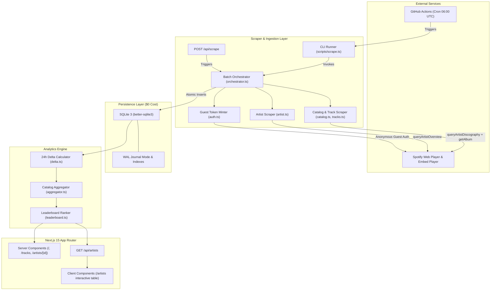
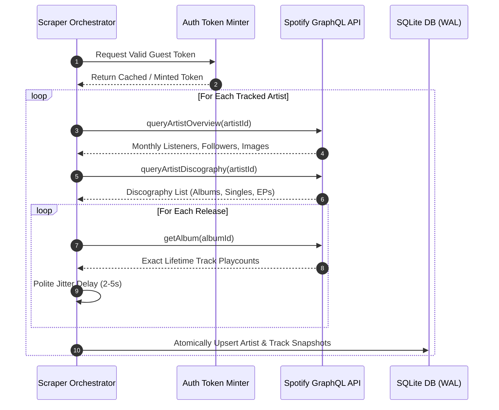

# DHH Pulse — Architecture & System Design

DHH Pulse is an autonomous stream intelligence and audience analytics platform dedicated to the Desi Hip Hop (DHH) ecosystem. The platform captures exact lifetime track playcounts, computes derived daily stream gains, monitors audience shifts, and renders a high-performance studio console dashboard.

---

## 1. High-Level System Architecture

---

## 2. Ingestion & Scraper Pipeline

### 2.1. The Spotify Pathfinder Challenge
Official Spotify Web API endpoints deliberately omit exact track playcounts and monthly listener counts, exposing only normalized popularity indices (0–100). DHH Pulse bypasses this limitation by interfacing directly with Spotify's internal **Pathfinder GraphQL API** used by open web players.

### 2.2. Dual Guest Token Minter (`src/lib/scraper/auth.ts`)
To operate entirely on a $0 budget without paid proxies or credentials, DHH Pulse mints anonymous guest access tokens through a resilient two-tier strategy:

1. **Tier 1 (Legacy Token Endpoint):** Queries `https://open.spotify.com/get_access_token?reason=transport&productType=web_player`.
2. **Tier 2 (Embed Player Fallback):** If Tier 1 is blocked at the edge (HTTP 403), DHH Pulse scrapes the server-rendered HTML of `https://open.spotify.com/embed/artist/<id>`, extracting embedded `accessToken` and `accessTokenExpirationTimestampMs` JSON fields.
3. **In-Memory Cache:** Tokens are cached in-memory and proactively refreshed 60 seconds before expiration.

### 2.3. Rate Limiting & Pacing Engine
To prevent IP rate limits (HTTP 429) on residential connections:
- **Strict Sequential Concurrency:** Only 1 artist is scraped at a time (`concurrency: 1`).
- **Polite Randomized Jitter:** Every request waits for a baseline delay of 2,000ms plus a random jitter up to 3,000ms ($2\text{s} - 5\text{s}$ total sleep between requests).
- **Exponential Backoff:** On transient network failures or rate limits, retries back off exponentially ($2^n \times \text{delay}$).

---

## 3. Storage Architecture: SQLite WAL Singleton

DHH Pulse uses `better-sqlite3` operating in Write-Ahead Logging (`WAL`) mode.

- **Singleton Pattern:** Only one database connection is opened per process (`src/lib/db/client.ts`).
- **Concurrency:** `PRAGMA journal_mode = WAL; PRAGMA synchronous = NORMAL; PRAGMA foreign_keys = ON;`. WAL allows unlimited concurrent reads while background writes occur without read locking.
- **Contract-Enforced Schema:** The database creates 4 core tables and 5 performance indexes defined in `DB_SCHEMA_CONTRACT`.
- **Parameterization:** 100% of SQL queries use parameterized prepared statements (`db.prepare(...)`), preventing SQL injection.

---

## 4. Analytics Engine & Mathematical Guarantees

### 4.1. Daily Stream Derivation
Because Spotify tracks accumulate lifetime streams continuously, daily streams are mathematically derived via snapshot differentiation:

$$\Delta \text{Streams}_{\text{track}, t} = \text{Playcount}_{\text{track}, t} - \text{Playcount}_{\text{track}, t-1}$$

### 4.2. Negative Delta Clamping (Metadata Migration Guard)
Spotify occasionally merges catalog metadata, deduplicates track ISRC codes, or shifts playcounts between releases. To prevent anomalous negative streams from corrupting daily leaderboards, DHH Pulse enforces strict zero-clamping:

$$\text{DailyStreams} = \max\left(0, \, \text{Playcount}_t - \text{Playcount}_{t-1}\right)$$

### 4.3. Catalog Aggregation
An artist's scene-wide daily volume is aggregated across their entire tracked discography:

$$\text{Total Daily Streams}_{\text{artist}, t} = \sum_{i=1}^{N} \Delta \text{Streams}_{i, t}$$

### 4.4. Audience Delta (Net Listener Change)
Unlike playcounts, monthly listeners fluctuate naturally up or down based on audience churn. Audience delta is preserved with signed values:

$$\Delta \text{Listeners}_{\text{artist}, t} = \text{MonthlyListeners}_t - \text{MonthlyListeners}_{t-1}$$

---

## 5. Presentation Layer & Frontend Craft Triad

The user interface follows the **Frontend Craft Triad** (`AGENTS.md`):

1. **Art Direction & Anti-Slop (Taste-Skill):**
   - Studio console aesthetic inspired by hardware audio synthesizers and mastering racks.
   - Deep void-black background (`#08080a`), hairline steel borders (`#26262d`), warm amber highlights (`#ffb020`), emerald gains (`#34d399`), rose declines (`#fb7185`).
   - Monospace tabular numerics (`JetBrains Mono`) for all counters and statistics.
   - Banned all generic AI defaults (no centered heroes, no purple SaaS gradient blobs, no generic 3-column cards).

2. **UX Architecture & Systems Craft (Impeccable):**
   - Complete 4-state surface coverage: Default, Loading Skeleton, Empty State, and Error Boundary on every view.
   - Strict mobile ergonomics: $\ge 44\text{px} \times 44\text{px}$ touch targets on all interactive elements.
   - WCAG AA contrast compliance verified ($\ge 4.5:1$ on text, up to $17.3:1$ contrast).

3. **Motion Physics (Emil Kowalski):**
   - 60fps GPU-composited motion: Transitions mutate **strictly** `transform` and `opacity`.
   - Scale animations emerge naturally from $0.95 \to 1.0$, never from $0$.
   - Tactile button depressions: `transform: scale(0.97)` on `:active`.
   - Dynamic viewport sizing using `100dvh` to prevent mobile address bar jumping.
