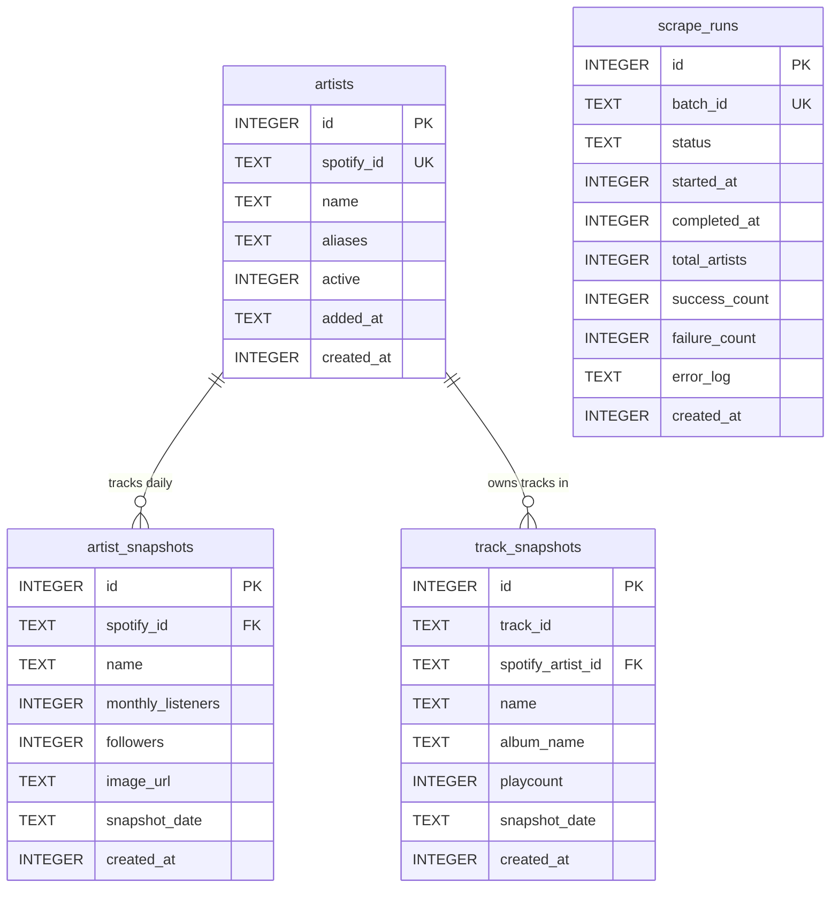

# DHH Pulse — Database & Storage Engine Specification

DHH Pulse relies on an embedded SQLite 3 database managed via `better-sqlite3`. Operating with zero cloud hosting expenses ($0 budget), the database stores all artist registries, daily audience snapshots, track playcount time-series, and scrape execution audit logs.

---

## 1. Engine Configuration & Pragmas

On initialization, the singleton connection in `src/lib/db/client.ts` executes the following performance pragmas:

```sql
PRAGMA journal_mode = WAL;
PRAGMA synchronous = NORMAL;
PRAGMA foreign_keys = ON;
```

### Why WAL (Write-Ahead Logging)?
- **High Read Concurrency:** Next.js Server Components and API routes read from the database without blocking background scraper writes.
- **Atomic Commits:** Writes append to a `.sqlite-wal` file, guaranteeing ACID integrity during unattended cron runs.
- **Fast Transactions:** Batch inserts commit significantly faster than standard rollback journaling.

---

## 2. Entity-Relationship Diagram (ERD)



---

## 3. Data Dictionary

### 3.1. `artists` (Master Registry)
Stores all tracked artists in the Desi Hip Hop ecosystem.

| Column | Type | Nullable | Constraints | Description |
|---|---|---|---|---|
| `id` | `INTEGER` | No | `PRIMARY KEY AUTOINCREMENT` | Internal synthetic sequence ID. |
| `spotify_id` | `TEXT` | No | `UNIQUE` | Spotify Artist URI ID (e.g. `5C1S9XwxMuuCciutwMhp5t`). |
| `name` | `TEXT` | No | None | Canonical display name (e.g. `KR$NA`). |
| `aliases` | `TEXT` | Yes | Valid JSON array | Search aliases and alternate names (e.g. `["Krishna Kaul"]`). |
| `active` | `INTEGER` | No | `DEFAULT 1` | `1` = actively scraped, `0` = deactivated. |
| `added_at` | `TEXT` | No | ISO 8601 Date (`YYYY-MM-DD`) | Date artist was added to tracking registry. |
| `created_at` | `INTEGER` | No | `DEFAULT (unixepoch() * 1000)` | Record creation timestamp in milliseconds. |

---

### 3.2. `artist_snapshots` (Daily Audience Metric)
Stores one audience metric snapshot per artist per calendar day.

| Column | Type | Nullable | Constraints | Description |
|---|---|---|---|---|
| `id` | `INTEGER` | No | `PRIMARY KEY AUTOINCREMENT` | Internal sequence ID. |
| `spotify_id` | `TEXT` | No | Composite Unique | Spotify Artist ID. |
| `name` | `TEXT` | No | None | Artist name at snapshot time. |
| `monthly_listeners` | `INTEGER` | No | None | Exact monthly listener count extracted from Spotify. |
| `followers` | `INTEGER` | No | None | Public Spotify follower count. |
| `image_url` | `TEXT` | Yes | None | Spotify CDN profile image URL (`i.scdn.co`). |
| `snapshot_date` | `TEXT` | No | Composite Unique | Target calendar date (`YYYY-MM-DD`). |
| `created_at` | `INTEGER` | No | `DEFAULT (unixepoch() * 1000)` | Snapshot timestamp in milliseconds. |

**Constraints:**
- `UNIQUE (spotify_id, snapshot_date)`: Guarantees exactly one audience record per artist per day. Duplicate scrapes perform atomic `INSERT OR REPLACE` / update.

---

### 3.3. `track_snapshots` (Daily Track Streams)
Stores one playcount record per track per calendar day.

| Column | Type | Nullable | Constraints | Description |
|---|---|---|---|---|
| `id` | `INTEGER` | No | `PRIMARY KEY AUTOINCREMENT` | Internal sequence ID. |
| `track_id` | `TEXT` | No | Composite Unique | Spotify Track ID. |
| `spotify_artist_id` | `TEXT` | No | None | Spotify Artist ID credited as primary or collaborator. |
| `name` | `TEXT` | No | None | Track title. |
| `album_name` | `TEXT` | No | None | Album / single title. |
| `playcount` | `INTEGER` | No | None | Exact lifetime playcount extracted from Pathfinder GraphQL. |
| `snapshot_date` | `TEXT` | No | Composite Unique | Target calendar date (`YYYY-MM-DD`). |
| `created_at` | `INTEGER` | No | `DEFAULT (unixepoch() * 1000)` | Snapshot timestamp in milliseconds. |

**Constraints:**
- `UNIQUE (track_id, snapshot_date)`: Guarantees exactly one playcount entry per track per day.

---

### 3.4. `scrape_runs` (Batch Execution Log)
Audits every scraper run with execution timings and error logs.

| Column | Type | Nullable | Constraints | Description |
|---|---|---|---|---|
| `id` | `INTEGER` | No | `PRIMARY KEY AUTOINCREMENT` | Internal sequence ID. |
| `batch_id` | `TEXT` | No | `UNIQUE` | UUID v4 for the scrape batch. |
| `status` | `TEXT` | No | `CHECK(status IN ('running', 'completed', 'failed'))` | Execution state. |
| `started_at` | `INTEGER` | No | None | Execution start timestamp (ms). |
| `completed_at` | `INTEGER` | Yes | None | Execution end timestamp (ms). |
| `total_artists` | `INTEGER` | No | `DEFAULT 0` | Total artists targeted in batch. |
| `success_count` | `INTEGER` | No | `DEFAULT 0` | Number of artists successfully scraped. |
| `failure_count` | `INTEGER` | No | `DEFAULT 0` | Number of artists failed. |
| `error_log` | `TEXT` | Yes | JSON array of strings | Serialized errors encountered during the run. |
| `created_at` | `INTEGER` | No | `DEFAULT (unixepoch() * 1000)` | Log creation timestamp (ms). |

---

## 4. Performance Indexes

Per `DB_SCHEMA_CONTRACT` in `src/types/contracts.ts`, 5 indexes are maintained:

```sql
-- 1. Accelerates artist profile time-series & trajectory lookups
CREATE INDEX IF NOT EXISTS idx_artist_snapshots_artist_date
  ON artist_snapshots (spotify_id, snapshot_date);

-- 2. Accelerates 24-hour track delta calculations between consecutive dates
CREATE INDEX IF NOT EXISTS idx_track_snapshots_track_date
  ON track_snapshots (track_id, snapshot_date);

-- 3. Accelerates catalog rollups across all tracks for a specific artist
CREATE INDEX IF NOT EXISTS idx_track_snapshots_artist_date
  ON track_snapshots (spotify_artist_id, snapshot_date);

-- 4. Optimizes scene-wide artist leaderboard queries filtered by date
CREATE INDEX IF NOT EXISTS idx_artist_snapshots_date
  ON artist_snapshots (snapshot_date);

-- 5. Optimizes scene-wide top gainer tracks queries filtered by date
CREATE INDEX IF NOT EXISTS idx_track_snapshots_date
  ON track_snapshots (snapshot_date);
```

---

## 5. Security & Query Guidelines

1. **100% Parameterized Statements:** All application queries MUST use parameterized variables (`?`). String concatenation into SQL queries is strictly banned:
   ```typescript
   // Correct
   const stmt = db.prepare("SELECT * FROM artist_snapshots WHERE spotify_id = ? AND snapshot_date = ?");
   const row = stmt.get(artistId, date);

   // Strictly Banned
   const stmt = db.prepare(`SELECT * FROM artist_snapshots WHERE spotify_id = '${artistId}'`);
   ```
2. **Graceful Connection Teardown:** CLI scripts must invoke `closeDb()` in a `finally` block to release WAL locks before process exit.
3. **Database Location:** Local files reside at `data/dhh-pulse.sqlite`. In GitHub Actions, the database file is restored from cache and committed back to the branch.
