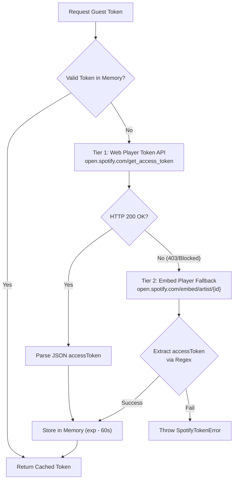

# DHH Pulse — Spotify Scraper & Ingestion Engine

This document details the internal architecture, GraphQL protocols, token acquisition strategies, and rate-limiting mechanics of the DHH Pulse scraper engine.

---

## 1. Why the Official Spotify API Is Insufficient

The official Spotify Web API (`api.spotify.com/v1`) intentionally hides:
1. **Exact Track Playcounts:** It provides only a relative `popularity` metric (an integer from 0 to 100), concealing whether a song has 10,000 or 100,000,000 streams.
2. **Exact Monthly Listeners:** The public API exposes follower counts, but omits monthly listeners.

To capture exact metrics, DHH Pulse queries Spotify's internal **Pathfinder GraphQL API** used by the desktop and web player (`open.spotify.com`).

---

## 2. Anonymous Guest Authentication (`src/lib/scraper/auth.ts`)

Operating on a $0 budget without paid proxy networks requires anonymous authentication that mimics official client sessions.

### Dual-Tier Token Minter



#### Tier 1: Web Player API
- Endpoint: `https://open.spotify.com/get_access_token?reason=transport&productType=web_player`
- Headers: `User-Agent`, `Accept: application/json`
- Note: Frequently edge-blocked (HTTP 403) by Cloudflare/Fastly depending on source IP ranges.

#### Tier 2: Embed Player Fallback
- Endpoint: `https://open.spotify.com/embed/artist/5C1S9XwxMuuCciutwMhp5t`
- HTML Parsing: Extracts token and expiration timestamp from embedded JSON:
  ```typescript
  const tokenMatch = html.match(/"accessToken":"([^"]+)"/);
  const expiryMatch = html.match(/"accessTokenExpirationTimestampMs":(\d+)/);
  ```
- Resilience: The embed player endpoint is globally accessible from standard consumer and datacenter IPs without edge blocking.

#### In-Memory Token Cache
Tokens last approximately 1 hour ($3600\text{s}$). DHH Pulse caches the token in-process and triggers automatic renewal 60 seconds before expiration (`expiresAtMs - 60_000`).

---

## 3. GraphQL Query Operations

All requests target `https://api-partner.spotify.com/pathfinder/v1/query`.

### 3.1. Artist Overview (`queryArtistOverview`)
Fetches monthly listeners, follower counts, verified status, and header/avatar image URLs.

```graphql
query queryArtistOverview($uri: ID!, $locale: String, $includePrerelease: Boolean!) {
  artistUnion(uri: $uri) {
    __typename
    ... on Artist {
      id
      profile {
        name
        verified
        biography { text }
      }
      visuals {
        avatarImage { sources { url width height } }
        headerImage { sources { url width height } }
      }
      stats {
        followers
        monthlyListeners
        topCities { items { city country numberOfListeners } }
      }
    }
  }
}
```

### 3.2. Artist Discography (`queryArtistDiscography`)
Discovers all albums, singles, and compilation releases in the artist's catalog.

```graphql
query queryArtistDiscography($uri: ID!, $offset: Int!, $limit: Int!) {
  artistUnion(uri: $uri) {
    ... on Artist {
      discography {
        all(offset: $offset, limit: $limit) {
          totalCount
          items {
            releases {
              items {
                id
                name
                type
                date { year month day }
                coverArt { sources { url } }
              }
            }
          }
        }
      }
    }
  }
}
```

### 3.3. Album Track Playcounts (`getAlbum`)
Fetches all track objects within a release, containing the **exact playcount** hidden from the public API.

```graphql
query getAlbum($uri: ID!, $locale: String, $offset: Int!, $limit: Int!) {
  albumUnion(uri: $uri) {
    ... on Album {
      tracksV2(offset: $offset, limit: $limit) {
        totalCount
        items {
          track {
            uri
            name
            playcount
            duration { milliseconds }
            trackNumber
            discNumber
            contentRating { label }
            artists { items { uri profile { name } } }
          }
        }
      }
    }
  }
}
```

---

## 4. Rate Limiting & Politeness Policy

To avoid IP rate limiting (HTTP 429) or IP blacklisting:

| Setting | Default Value | Purpose |
|---|---|---|
| `concurrency` | `1` | Strictly sequential execution. Parallel scraping is disallowed. |
| `baseDelayMs` | `2000ms` | Minimum pause between successive network requests. |
| `maxJitterMs` | `3000ms` | Randomized delay added to baseline ($2000 - 5000\text{ms}$ total sleep). |
| `maxRetries` | `3` | Maximum retry attempts for transient network or 429 errors. |
| `backoffMultiplier`| `2` | Multiplier for exponential backoff on retry ($4\text{s}, 8\text{s}, 16\text{s}$). |

---

## 5. CLI Execution & Scraper Operation

### 5.1. Running the Scraper Standalone

```bash
# 1. Full catalog discovery across all 21 active artists
npx tsx scripts/scrape.ts

# 2. Quick update (updates audience stats and known tracks; skips full catalog discovery)
npx tsx scripts/scrape.ts --quick

# 3. Targeted scrape for a single artist
npx tsx scripts/scrape.ts --artist 5C1S9XwxMuuCciutwMhp5t

# 4. Custom pacing delay (e.g. 4000ms baseline)
npx tsx scripts/scrape.ts --delay 4000
```

### 5.2. Adding an Artist to the Registry

To track a new DHH artist:
1. Locate their public Spotify profile (e.g., `https://open.spotify.com/artist/4Ai0pGz6GhQavjzaRhPTvz`).
2. Extract their Spotify Artist ID (`4Ai0pGz6GhQavjzaRhPTvz`).
3. Add an entry to `src/config/artists.ts`:

```typescript
{
  spotifyId: toSpotifyArtistId("4Ai0pGz6GhQavjzaRhPTvz"),
  name: "DIVINE",
  aliases: ["Vivian Fernandes"],
  active: true,
  addedAt: "2026-11-24",
}
```
4. Run `npx tsx scripts/scrape.ts --artist 4Ai0pGz6GhQavjzaRhPTvz` to seed their initial snapshot.
