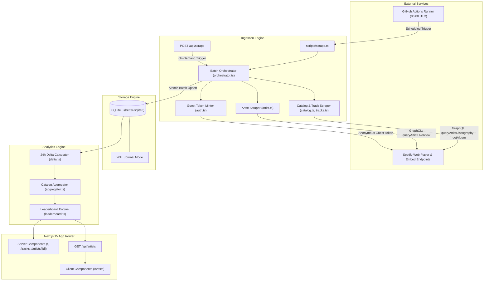

# System Architecture

## 1. System Overview

DHH Pulse is an autonomous stream intelligence and audience analytics platform dedicated to the Desi Hip Hop music ecosystem. The application tracks lifetime playcounts, derives daily stream increases, captures audience metrics, and displays trajectory analytics for over 20 artists and their complete track discographies.

The system is designed for zero cloud infrastructure costs ($0 budget), executing all ingestion, storage, analytics, and presentation within a self-hosted Next.js and SQLite runtime.

---

## 2. Major Components and Responsibilities

| Component | File Location | Responsibility |
|---|---|---|
| **Domain Contracts** | `src/types/contracts.ts` | Central source of truth defining branded types, API contracts, DDL schema specifications, and component prop interfaces. Strictly read-only. |
| **Token Minter** | `src/lib/scraper/auth.ts` | Acquires anonymous Spotify guest tokens via web player transport endpoints with an automatic fallback to embed player HTML scraping. Manages in-memory token expiry. |
| **Scraper Core** | `src/lib/scraper/` | Queries Spotify's internal Pathfinder GraphQL endpoints to extract monthly listeners, follower counts, full discography catalogs, and lifetime track playcounts. |
| **Batch Orchestrator** | `src/lib/scraper/orchestrator.ts` | Executes sequential artist processing with randomized jitter (2,000–5,000ms pause) and exponential backoff, recording execution audit logs in `scrape_runs`. |
| **Database Client** | `src/lib/db/client.ts` | Singleton connection wrapper for `better-sqlite3` enforcing WAL mode and executing idempotent schema creation on boot. |
| **Delta Engine** | `src/lib/analytics/delta.ts` | Calculates 24-hour playcount and audience changes by comparing consecutive snapshots, enforcing zero-clamping for negative deltas. |
| **Catalog Aggregator** | `src/lib/analytics/aggregator.ts` | Rolls up track deltas across an artist's full catalog, identifies top-performing songs, and compiles 30-day historical trajectory curves. |
| **Leaderboard Engine** | `src/lib/analytics/leaderboard.ts` | Sorts and paginates artist and track performance tables across 5 distinct ranking dimensions. |
| **Application Presentation** | `src/app/` | Next.js 15 App Router delivering server-rendered dashboards, client-side table interactions, and REST endpoints. |

---

## 3. Communication and Data Flow

1. **Ingestion Trigger:** An automated cron job (`workflows/daily-scrape.yml`) or manual CLI invocation executes `scripts/scrape.ts`.
2. **Authentication:** The scraper verifies whether an unexpired guest token exists in memory. If absent, it requests a new token from Spotify's web player service.
3. **Data Retrieval:** The orchestrator iterates through active artists in `src/config/artists.ts`. For each artist, it fetches high-level audience metrics, followed by release discovery and track playcounts.
4. **Rate-Limiting Jitter:** A randomized delay of 2,000ms baseline plus up to 3,000ms jitter is injected between requests to prevent IP rate-limiting.
5. **Persistence:** Raw metrics are written into `artist_snapshots` and `track_snapshots` using parameterized SQLite statements.
6. **Analytics Execution:** Presentation components query `getLeaderboard()` or `getTopGainerTracks()`. The delta engine executes SQL difference queries, applies negative clamping, and returns sorted response models.
7. **Rendering:** Next.js Server Components compile static and dynamic views, delivering high-contrast dark theme interfaces to the browser.
