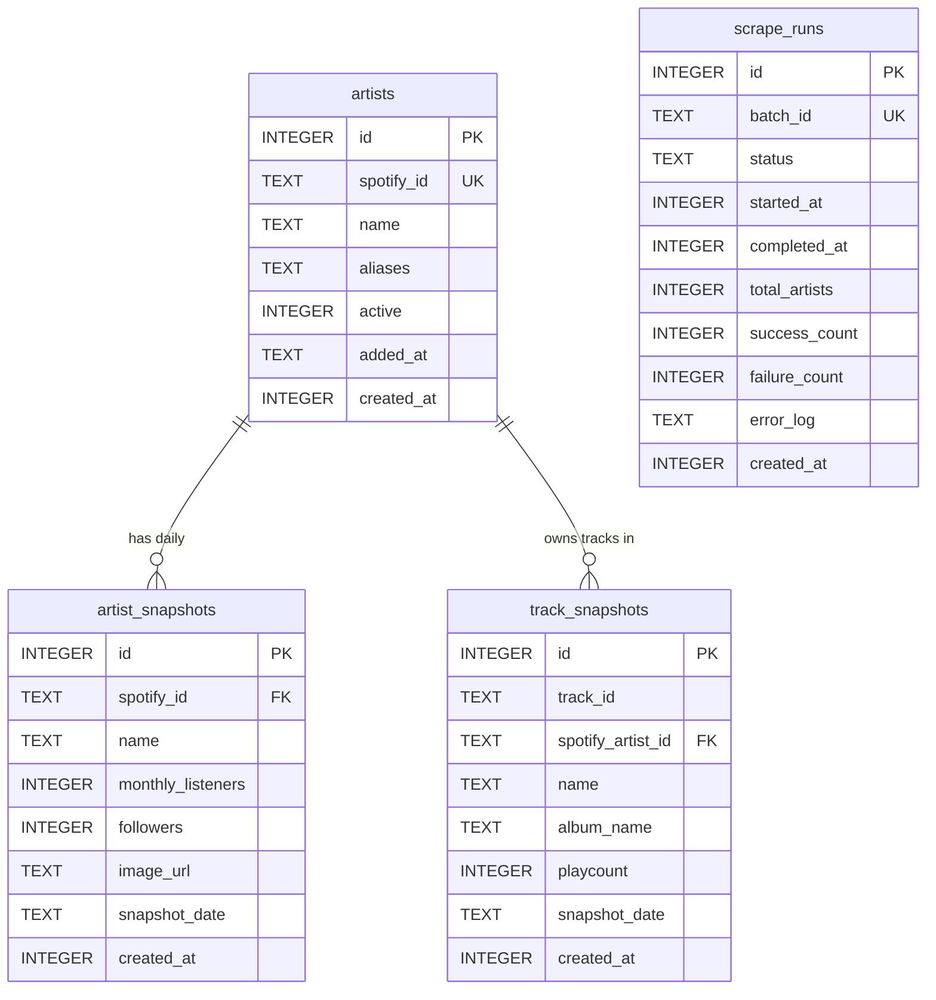

# Database Design and Storage Architecture

## 1. Database Technology and Configuration

DHH Pulse uses an embedded SQLite 3 database managed via the synchronous Node.js driver `better-sqlite3`. Operating on local storage, the database incurs $0 in external cloud database hosting fees.

### Engine Pragmas
On initialization (`src/lib/db/client.ts`), the following PRAGMAs are executed:

```sql
PRAGMA journal_mode = WAL;
PRAGMA synchronous = NORMAL;
PRAGMA foreign_keys = ON;
```

### Technical Benefits of WAL Mode
- **Concurrent Non-Blocking Reads:** Readers do not block writers, and writers do not block readers. Server Components and API queries continue serving traffic while the scraper commits snapshots in the background.
- **Fast Sequential Appends:** Changes are appended to the write-ahead log (`data/dhh-pulse.sqlite-wal`) rather than requiring full database file rewrites.

---

## 2. Entity-Relationship Model



---

## 3. Data Dictionary

### Table: `artists` (Master Registry)
Maintains the authoritative registry of tracked Desi Hip Hop artists.

| Column | Type | Nullable | Default | Constraints | Description |
|---|---|---|---|---|---|
| `id` | `INTEGER` | No | AUTOINCREMENT | `PRIMARY KEY` | Synthetic row identifier. |
| `spotify_id` | `TEXT` | No | None | `UNIQUE` | Spotify Artist URI identifier (e.g. `5C1S9XwxMuuCciutwMhp5t`). |
| `name` | `TEXT` | No | None | None | Canonical display name of the artist. |
| `aliases` | `TEXT` | Yes | NULL | JSON Array | Alternate names or spellings for search. |
| `active` | `INTEGER` | No | `1` | None | Flag indicating whether artist is actively tracked (1=true, 0=false). |
| `added_at` | `TEXT` | No | None | ISO 8601 Date | Date artist was added to the tracking system (`YYYY-MM-DD`). |
| `created_at` | `INTEGER` | No | `(unixepoch() * 1000)` | None | Timestamp in milliseconds when row was inserted. |

### Table: `artist_snapshots` (Daily Audience Metrics)
Stores daily listener and follower records per artist.

| Column | Type | Nullable | Default | Constraints | Description |
|---|---|---|---|---|---|
| `id` | `INTEGER` | No | AUTOINCREMENT | `PRIMARY KEY` | Synthetic row identifier. |
| `spotify_id` | `TEXT` | No | None | Composite Unique | Spotify Artist ID. |
| `name` | `TEXT` | No | None | None | Artist name at time of scrape. |
| `monthly_listeners` | `INTEGER` | No | None | None | Exact monthly listeners count. |
| `followers` | `INTEGER` | No | None | None | Spotify public follower count. |
| `image_url` | `TEXT` | Yes | NULL | None | CDN URL of the artist avatar image. |
| `snapshot_date` | `TEXT` | No | None | Composite Unique | Target calendar date (`YYYY-MM-DD`). |
| `created_at` | `INTEGER` | No | `(unixepoch() * 1000)` | None | Timestamp in milliseconds. |

**Composite Key:** `UNIQUE (spotify_id, snapshot_date)` ensures idempotency. Re-running a scrape on the same calendar day updates the existing record.

### Table: `track_snapshots` (Daily Track Playcounts)
Stores daily lifetime playcount snapshots for individual songs.

| Column | Type | Nullable | Default | Constraints | Description |
|---|---|---|---|---|---|
| `id` | `INTEGER` | No | AUTOINCREMENT | `PRIMARY KEY` | Synthetic row identifier. |
| `track_id` | `TEXT` | No | None | Composite Unique | Spotify Track ID. |
| `spotify_artist_id` | `TEXT` | No | None | None | Spotify Artist ID credited on the track. |
| `name` | `TEXT` | No | None | None | Title of the track. |
| `album_name` | `TEXT` | No | None | None | Title of the parent album or single release. |
| `playcount` | `INTEGER` | No | None | None | Exact lifetime playcount extracted from Pathfinder GraphQL. |
| `snapshot_date` | `TEXT` | No | None | Composite Unique | Target calendar date (`YYYY-MM-DD`). |
| `created_at` | `INTEGER` | No | `(unixepoch() * 1000)` | None | Timestamp in milliseconds. |

**Composite Key:** `UNIQUE (track_id, snapshot_date)` prevents duplicate track records for any single day.

### Table: `scrape_runs` (Batch Execution Log)
Audits batch scraper execution runs, duration, and error traces.

| Column | Type | Nullable | Default | Constraints | Description |
|---|---|---|---|---|---|
| `id` | `INTEGER` | No | AUTOINCREMENT | `PRIMARY KEY` | Synthetic row identifier. |
| `batch_id` | `TEXT` | No | None | `UNIQUE` | UUID v4 identifier for the execution batch. |
| `status` | `TEXT` | No | None | `CHECK(status IN ('running', 'completed', 'failed'))` | Current lifecycle state. |
| `started_at` | `INTEGER` | No | None | None | Start timestamp in milliseconds. |
| `completed_at` | `INTEGER` | Yes | NULL | None | Completion timestamp in milliseconds. |
| `total_artists` | `INTEGER` | No | `0` | None | Total number of artists targeted in the run. |
| `success_count` | `INTEGER` | No | `0` | None | Count of successfully processed artists. |
| `failure_count` | `INTEGER` | No | `0` | None | Count of failed artists. |
| `error_log` | `TEXT` | Yes | NULL | JSON Array | Serialized array of error strings encountered. |
| `created_at` | `INTEGER` | No | `(unixepoch() * 1000)` | None | Timestamp in milliseconds. |

---

## 4. Performance Indexes

Five specialized indexes are created per `DB_SCHEMA_CONTRACT` in `src/types/contracts.ts`:

1. `idx_artist_snapshots_artist_date`:
   ```sql
   CREATE INDEX IF NOT EXISTS idx_artist_snapshots_artist_date
     ON artist_snapshots (spotify_id, snapshot_date);
   ```
   *Purpose:* Accelerates single-artist historical time-series queries and consecutive-day delta comparisons.

2. `idx_track_snapshots_track_date`:
   ```sql
   CREATE INDEX IF NOT EXISTS idx_track_snapshots_track_date
     ON track_snapshots (track_id, snapshot_date);
   ```
   *Purpose:* Optimizes track-level 24-hour delta calculations between today and yesterday.

3. `idx_track_snapshots_artist_date`:
   ```sql
   CREATE INDEX IF NOT EXISTS idx_track_snapshots_artist_date
     ON track_snapshots (spotify_artist_id, snapshot_date);
   ```
   *Purpose:* Accelerates catalog rollup queries aggregating all track stream gains for an artist on a given date.

4. `idx_artist_snapshots_date`:
   ```sql
   CREATE INDEX IF NOT EXISTS idx_artist_snapshots_date
     ON artist_snapshots (snapshot_date);
   ```
   *Purpose:* Optimizes scene-wide leaderboard queries filtered by a specific snapshot date.

5. `idx_track_snapshots_date`:
   ```sql
   CREATE INDEX IF NOT EXISTS idx_track_snapshots_date
     ON track_snapshots (snapshot_date);
   ```
   *Purpose:* Optimizes scene-wide top gainer tracks queries filtered by date.
